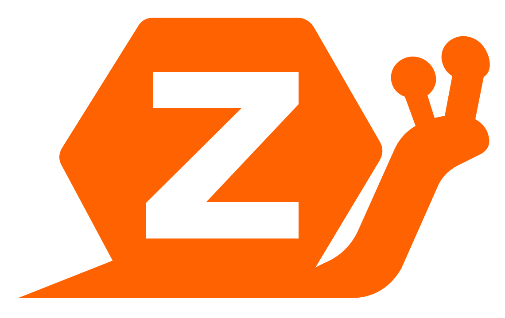

# Zluggish

Zluggish is an open-source server for riding in Zwift on your own network. Ride any world on your own or with friends on the same server. Race previous rides as ghosts, set up custom pacers and pelotons, and browse activities in the management web app.

Rides and progress stay on your server. Official events and global leaderboards are unavailable. You can connect supported services to share activities or sync workouts.

## Get started

1. Check the [server and client requirements](https://docs.zluggish.com/install/requirements/).
2. [Install the server and create an administrator](https://docs.zluggish.com/install/server/).
3. Set up Zwift on [Windows](https://docs.zluggish.com/install/clients/windows/), [macOS](https://docs.zluggish.com/install/clients/macos/), [Linux with Wine](https://docs.zluggish.com/install/clients/linux/) or [Android](https://docs.zluggish.com/install/clients/android/).
4. Get the [Companion app for Android](https://docs.zluggish.com/install/clients/companion-android/).

## Documentation

- [Web app](https://docs.zluggish.com/usage/web-app/)
- [Activity and workout integrations](https://docs.zluggish.com/usage/integrations/)
- [Back up and restore](https://docs.zluggish.com/maintenance/backup-and-restore/)
- [Configuration](https://docs.zluggish.com/reference/configuration/)
- [Remote access](https://docs.zluggish.com/install/remote-access/)
- [Development and CI](docs/development.md) and [contributing](CONTRIBUTING.md)

See the [changelog](CHANGELOG) before updating. Join the community on [Discord](https://discord.gg/GMdn8F8) or [Strava](https://www.strava.com/clubs/zoffline).

## Legal notice

Zluggish builds on [zwift-offline](https://github.com/zoffline/zwift-offline) and [fatsbrown's fork](https://github.com/fatsbrown/zwift-offline). It is an independent community project with no affiliation with or endorsement by Zwift, Inc. Zwift is a trademark of Zwift, Inc.

Zluggish is licensed under the [GNU Affero General Public License, version 3](LICENSE). Third-party components retain their own licenses. The Zluggish license does not grant rights to the Zwift client, game assets or trademarks.
