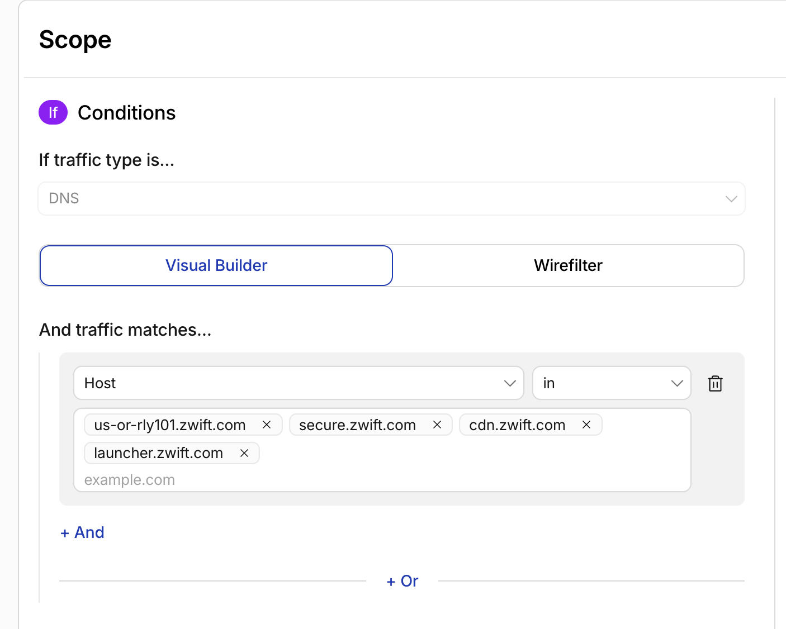
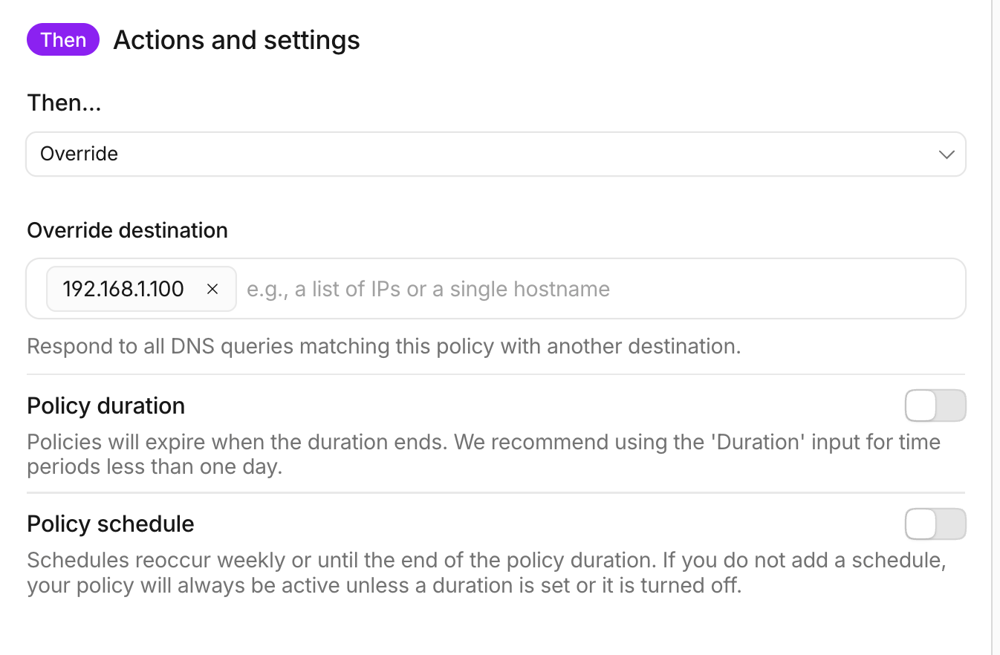

# Remote access

By default, Zluggish listens to `127.0.0.1` which means it only accepts request from the local machine. This is fine if you are running Zwift on the same machine, but you will get an insecure http connection warning when browsing to the webapp.

You can set up remote access to Zluggish in several ways, including a simple reverse proxy (only secure if restricted to your local network), Wireguard Tailscale or Cloudflare Tunnel. This guide will show how to set up Cloudflare.

With this setup, you will get a TLS certificate for the webapp and you and your friends can run the Zwift app from any location.

| Access                    | What to set up                                                                                                                     |
| ------------------------- | ---------------------------------------------------------------------------------------------------------------------------------- |
| [Web app](#web-app)       | Publish an HTTPS hostname with Cloudflare Access. The tunnel forwards requests to the Zluggish HTTP listener.                      |
| [Zwift game](#zwift-game) | Route the server's private IP over the tunnel. Install the Cloudflare One Client on each Zwift device for game HTTPS, TCP and UDP. |

Both need a Cloudflare account and a [tunnel with `cloudflared`](https://developers.cloudflare.com/cloudflare-one/networks/connectors/cloudflare-tunnel/get-started/create-remote-tunnel/) running where it can reach Zluggish. You can use the same tunnel for both.

## Web app

1. Choose a hostname on a domain you manage in Cloudflare, such as `zluggish.example.com`.
2. [Create a self-hosted Access app](https://developers.cloudflare.com/cloudflare-one/access-controls/applications/http-apps/self-hosted-public-app/) for that hostname. Add an Allow policy for the people who need access.
3. Add a **Published application** route to your tunnel. Use service URL `http://localhost:8080` if `cloudflared` runs on the server, or `http://<server-ip>:8080` if it runs elsewhere. Enable **Protect with Access**.
4. In `zluggish.config.ts`, set `network.web.publicUrl` to the full HTTPS origin, such as `https://zluggish.example.com`.
5. Restart Zluggish, then open the HTTPS address and sign in.

Cloudflare provides HTTPS to the browser. Zluggish uses the configured origin to validate changes and mark session cookies secure.

## Zwift game

Zwift connects using the original Zwift hostnames and needs TCP port 3025 and UDP port 3024 for riding, in addition to HTTPS 443 and HTTP 80. Use a private route for these [game ports](../reference/ports.md).

1. Add a **CIDR** route to the tunnel for the server's private IP, for example `192.168.1.10/32`.
2. In the Cloudflare One device profile, [configure Split Tunnels](https://developers.cloudflare.com/cloudflare-one/team-and-resources/devices/cloudflare-one-client/configure/route-traffic/split-tunnels/) so the server IP goes through the tunnel. In **Include** mode, add the route. In **Exclude** mode, adjust any excluded range that contains the server IP.
3. Enable [TCP and UDP proxying](https://developers.cloudflare.com/cloudflare-one/traffic-controls/proxy/).
4. Set `server.advertisedIp` to that private IP in `zluggish.config.ts` and restart Zluggish.
5. [Enroll the Cloudflare One Client](https://developers.cloudflare.com/cloudflare-one/team-and-resources/devices/warp/) on each Zwift device. Connect it in **Traffic and DNS** mode.
6. Follow the setup guide for [Windows](clients/windows.md), [macOS](clients/macos.md), [Linux](clients/linux.md) or [Android](clients/android.md) to install the certificate or patched app. Use the private IP in the desktop hosts file or set a Gateway DNS override below.

If port 8080 is reachable over the private route and the web listener is enabled, open `http://<server-ip>:8080/health` on the Zwift device to check the route. Use different IP ranges at home and at the remote location to avoid routing conflicts.

### Redirect the Zwift names with Gateway DNS

Use a [Gateway DNS policy](https://developers.cloudflare.com/cloudflare-one/traffic-controls/dns-policies/#override) to resolve the Zwift hostnames to the private IP.

1. Use the **Host** selector and **in** operator: `secure.zwift.com`, `us-or-rly101.zwift.com`, `cdn.zwift.com` and `launcher.zwift.com`.

   

2. Set the action to **Override** and enter the server's private IP in **Override destination**. Replace the example `192.168.1.100` below with your server's private IP.

   

## Show each household only its own riders

When riders reach the game through the Cloudflare One Client, the launcher can list only the riders that belong to the person signed in to Cloudflare. A Cloudflare Gateway HTTP policy adds that person's email to each launcher request. Zluggish then shows the riders in that email's groups, and the rider whose login name is that email.

The filter decides who appears in the rider list. It does not replace passwords: a rider whose password this computer does not remember still enters it. The web app and the Android apps are not filtered.

### Turn on TLS decryption

Gateway can only change request headers when it [decrypts HTTPS](https://developers.cloudflare.com/cloudflare-one/traffic-controls/http-policies/tls-decryption/). Turn on TLS decryption, and [let the Cloudflare One Client install the Cloudflare certificate](https://developers.cloudflare.com/cloudflare-one/team-and-resources/devices/user-side-certificates/automated-deployment/) on each Zwift device with **Install CA to system certificate store**. That works on Windows, macOS and Debian-based Linux. On other devices, install the certificate by hand.

Gateway only sees traffic that enters the Cloudflare One Client. Keep the Split Tunnels in **Include** mode with only the server's private IP, as in [Zwift game](#zwift-game), and everything else on the device goes straight to the internet: it is neither routed through Cloudflare nor decrypted.

The server IP must be in the Include list even for devices on the same network as the server. Without it they reach Zluggish directly, Gateway never sees the request, and the launcher asks them to connect through Cloudflare.

With decryption on, Zwift devices see a Cloudflare certificate for `secure.zwift.com` instead of the Zluggish one. Browsers and the launcher trust it through the system certificate store, but the game itself only trusts its own list, `data/cacert.pem` in the Zwift folder. To add the Cloudflare certificate to that list:

1. In Cloudflare One, open the inspection certificates under **Traffic policies** > **Traffic settings** and download the one that is **In-use**.
2. In the Zluggish web app, open **Manage** > **Launcher access** and select **Upload certificate** under **Cloudflare Gateway**. Both `.pem` and `.crt` files work.
3. Download and run the client setup again on each desktop Zwift device. It adds the Cloudflare certificate to Zwift's list next to the Zluggish one.

The patched Android apps may trust only the Zluggish certificate. If they stop connecting, add a Do Not Inspect policy for those devices.

### Make a secret

Gateway sends a secret with each request so Zluggish knows the email came from Cloudflare. In the web app, open **Manage** > **Launcher access** and select **Make secret** under **Cloudflare Gateway**. Copy the secret into the policy in the next step.

The web app shows the secret only once and keeps only a hash of it. If the policy's copy is lost, select **Replace secret** and paste the new one into the policy. Launchers that come through Gateway ask riders to connect through Cloudflare until the policy has the new secret.

Making the secret turns the Gateway check on. **Remove secret** turns it off again, and every launcher lists every rider, unless [Access sign-in](#sign-in-without-the-cloudflare-one-client) is set up.

### Add the Gateway HTTP policy

[Create an HTTP policy](https://developers.cloudflare.com/cloudflare-one/traffic-controls/http-policies/tenant-control/) that adds the headers to launcher requests:

| Field                        | Value                                                               |
| ---------------------------- | ------------------------------------------------------------------- |
| Selector                     | **Host** **in** `secure.zwift.com`                                  |
| Action                       | **Allow**                                                           |
| Untrusted certificate action | **Pass through**. The Zluggish certificate is self-signed.          |
| Modify request headers       | **Overwrite** `X-Zluggish-Identity` with `@{identity.email}`        |
|                              | **Overwrite** `X-Zluggish-Gateway` with the secret from the web app |

Use **Overwrite**, not **Add**. Overwrite replaces any value the device sent, so nobody can claim another email.

### Choose who sees which riders

In the web app, open **Manage** > **Launcher access**. The groups take effect once the Gateway secret or [Access sign-in](#sign-in-without-the-cloudflare-one-client) is set up.

- Each group lists emails and riders. Everyone signed in to Cloudflare with one of the emails sees all of the group's riders.
- An email can be in several groups, and a rider can be in several groups.
- A rider whose login name is an email is visible to that email without any group.
- **Riders no launcher can pick** lists riders in no group whose login name is not an email. Add each one to a group.
- **Waiting for a group** lists emails that opened the launcher but matched no rider, so you can add them without typing.

Changes take effect the next time the launcher loads its rider list.

### What riders see

- Signed in to Cloudflare with an email that has riders: only those riders, and a line naming the email.
- Signed in with an email that has no riders: a page asking them to contact an administrator.
- Not connected through the Cloudflare One Client, or Cloudflare could not tell who is signed in: a page asking them to connect and check again. This includes riders on the home network who do not use the Cloudflare One Client. With [Access sign-in](#sign-in-without-the-cloudflare-one-client) set up, the page also offers **Sign in with Cloudflare**.

## Sign in without the Cloudflare One Client

Some devices cannot run your Cloudflare One Client, such as a work laptop that must run its employer's. Their launchers can sign in through the Cloudflare Access application of the [web app](#web-app) instead. The same groups then decide which riders they see.

1. In Cloudflare One, open the web app's Access application and copy its **Application Audience (AUD) Tag**.
2. Note your team domain, such as `example.cloudflareaccess.com`. It is under **Settings** in Cloudflare One.
3. Set both in `zluggish.config.ts`. `network.web.publicUrl` must be the web app's https address, and the Access application must cover the whole hostname:

   ```ts
   network: {
     web: {
       publicUrl: 'https://zluggish.example.com',
       cloudflareAccess: { teamDomain: 'example.cloudflareaccess.com', audience: '<AUD tag>' },
     },
   },
   ```

4. Restart Zluggish.

In the launcher, the rider selects **Sign in with Cloudflare** and signs in to your Access application. The launcher then returns to the rider list and stays signed in for 30 days. Who may sign in is up to the Access application's policies, and which riders they see is up to the groups.

Access sign-in works alone or together with the Gateway headers. When a request carries both, the Gateway email wins.
